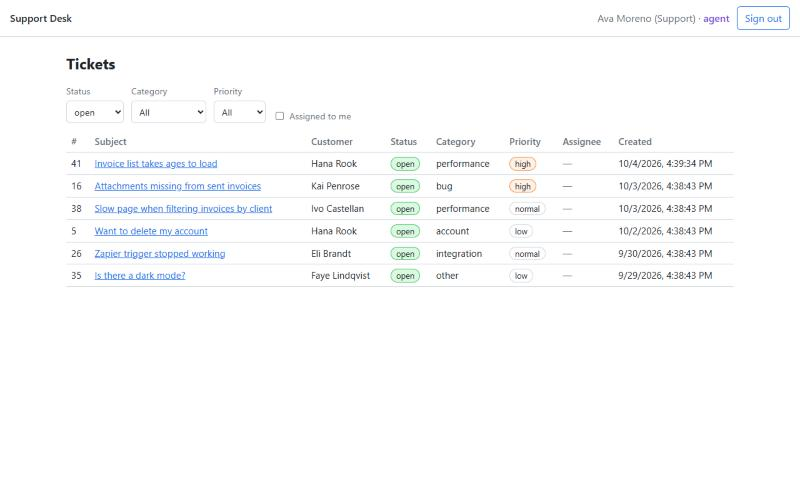
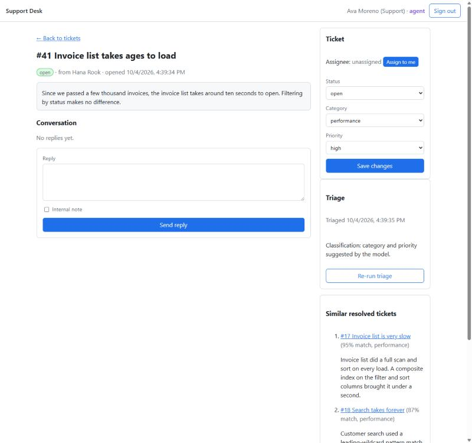
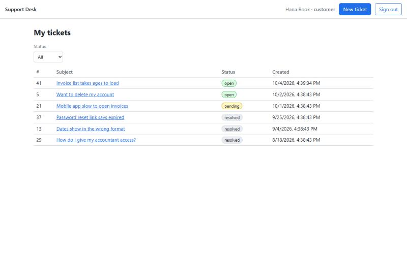

# Supabase Support Desk

[](https://github.com/vybetechlabs-blip/supabase-support-desk/actions/workflows/ci.yml)

A small support desk built on Supabase, with a troubleshooting lab that reproduces four Supabase problems and fixes each one.

## Problem and result
Row level security is easy to get subtly wrong, and the failures look like something else: a customer who can read internal notes, a 403 on a reply that should work, a ticket list that slows down a little every week, and a count that is fast in the SQL editor and slow in the app.

In one recorded run on 2026-10-04, on a Windows 11 machine with 50,000 extra tickets loaded, the agent ticket list went from a median 13.1 ms to 0.8 ms once an index matched its query. A count that took a median 169.5 ms through the API, against 6.0 ms in the SQL editor, took 6.6 ms after the role check was wrapped in a sub-select. The database suite has 96 pgTAP assertions in 9 files, and 10 unit tests cover the classifier.

This repo is a support desk where customers file tickets and agents work them. Row level security decides who sees what, in the Data API, in Realtime and in the similar-ticket search. An Edge Function triages every new ticket by storing an embedding and, when a key is set, a category and priority. [`TROUBLESHOOTING.md`](TROUBLESHOOTING.md) is the other half of the project: it breaks the desk four ways, two row level security bugs and two performance problems, and for each one gives the diagnosis, a fix migration and a test that fails before the fix and passes after.

## Screenshots

Local stack with the demo data, captured 2026-10-04.

**Agent ticket list.** Every customer's open tickets, with filters.



**Agent view of a new ticket.** The customer's ticket was classified on creation
(performance / high); the Triage box shows the recorded outcome, and the
Similar resolved tickets panel lists earlier tickets with their resolutions.



**Customer view.** A customer sees only their own tickets.



## Contents

- [Decision log](#decision-log)
- [How AI was used](#how-ai-was-used)
- [Requirements](#requirements)
- [Setup from a fresh clone](#setup-from-a-fresh-clone)
- [Walkthrough](#walkthrough)
- [Architecture](#architecture)
- [Ticket triage](#ticket-triage)
- [Tests](#tests)
- [Troubleshooting lab](#troubleshooting-lab)
- [Commands](#commands)
- [Project layout](#project-layout)
- [Limitations](#limitations)
- [License](#license)
- [Status](#status)

## Decision log
**1. Row level security on every table, with the role check wrapped in a sub-select.**
Chosen: every table has a policy for select, insert, update and delete, and operations that no client may perform get an explicit `false` policy, so the intent is visible in `pg_policies` and covered by a test. Policies call `private.is_agent()`, a `SECURITY DEFINER` function in a schema the API does not expose, wrapped as `(select private.is_agent())` so Postgres runs it once per statement. A test fails if any policy calls it, or `auth.uid()`, without the wrapper.
Rejected: a role claim in the JWT, set by a custom access token hook. The claim only changes when the token refreshes, so a demoted agent would keep agent access until then. A table lookup cached per statement is current on every query and needs no hook.
Known limits: the wrapper is easy to forget, and scenario 4 of the lab shows what that costs: a median 169.5 ms against 6.6 ms for the same count. Agents can edit any ticket column through the API, including the triage fields; only the assignee is checked.

**2. The server sets timestamps on API inserts.**
Chosen: a `BEFORE INSERT` trigger overwrites `created_at`, and `updated_at` on tickets, with `now()` when the role is `anon` or `authenticated`. Without it a client could future-date a ticket to the top of the agent list, which sorts by `created_at`, or backdate a reply.
Known limits: the table owner can still write historical values, which the seed data, the lab and the migrations rely on.

**3. The browser holds the publishable key only.**
Chosen: every request runs as `anon` or `authenticated`, so row level security applies. `src/lib/supabase.ts` refuses to start if the key variable holds a secret key. The secret key is used only inside the Edge Function, where the platform injects it.

**4. Similar tickets come from a function that runs with the caller's rights.**
Chosen: `public.similar_tickets` is `SECURITY INVOKER`, so the tickets policies apply to the source ticket and to every candidate. Agents get matches from all resolved tickets and a customer only from their own. Results are ranked by inner product, which equals cosine similarity for the normalized `gte-small` vectors.
Known limits: there is no vector index. An exact scan is fast and correct at this size, and an HNSW index would be the next step for a large table. `gte-small` handles English only and reads at most 512 tokens, and no cut-off is applied, so a ticket with no real precedent still gets three suggestions.

**5. Triage always stores an embedding, and classifies only what is empty and only with a key.**
Chosen: the Edge Function stores a 384-dimension embedding from the `gte-small` model built into Supabase Edge Functions, which needs no key. With `ANTHROPIC_API_KEY` set it also asks Claude Haiku 4.5 for a category and a priority, fills only the fields that are still empty, and makes no model call when both are set. Without a key there is no keyword-based guess. The outcome (`classified`, `no_key`, `failed` or `skipped`) is stored on the ticket, and `triaged_at` is set on every run, which limits a customer to one run per ticket. Classification lives in `classify.ts` with the model client passed in, so its failure handling is unit-tested with fake clients.
Known limits: nothing retries automatically, so a ticket triaged during an outage keeps empty fields until Re-run triage is pressed. There is no rate limit on classifier calls: with a key set, every new ticket costs one model call, triggered from the customer's browser. Priority is a suggestion made from customer-written text.

**6. Sign-up always creates a customer.**
Chosen: a trigger creates the profile at sign-up as a customer and never reads the role from user-supplied metadata. A display name over 100 characters is cut to 100 instead of failing the whole sign-up.
Known limits: the only way to get the agent role is an update to `profiles` in the database.

**7. The demo product has an invented name.**
Chosen: the fictional product in the seed data and in the classifier prompt is Brannoway, and a unit test asserts that the prompt uses it.
Rejected: Tallybook, which is a real expense-tracking app.

**8. Each lab fix is proved by a test that fails first, and the logs are committed.**
Chosen: every scenario resets the local database, reproduces the problem, gathers evidence, requires its test to fail, applies the fix and requires the test to pass. The tests check plan shapes or call counts, not timings, so they give the same answer on any machine. The logs of the recorded run are committed under `lab/evidence/`, and every number in `TROUBLESHOOTING.md` is tagged by how it was measured. The lab raises the statistics target on `tickets.status`, so `ANALYZE` reads the whole table.
Rejected: the default `ANALYZE` sample. It read 30,000 random rows of 50,040, and the planner estimates differed between runs.
Known limits: timings depend on the machine and vary from run to run. The first statement in a new database session reads 55 to 58 extra catalog pages, so a buffer figure can differ by a page or two.

**9. The project runs on the local stack, and CI covers what runs without Docker.**
Chosen: the app, the pgTAP suite and the lab run on the local Supabase stack, and the project has not been deployed to a hosted Supabase project. The seed writes directly into `auth.users` and `auth.identities`, with the CLI pinned to 2.119.0. CI runs `npm install`, the build, the linter and the classifier unit tests on Node 24.
Known limits: the pgTAP suite and the lab need Docker, so CI does not run them. A later Auth schema change could break the seed.

## How AI was used
_Placeholder. The repository author writes this section._

## Requirements

- **Node.js.** Developed and tested on Node 24.16. The stated minimum is 22.18
  (Vite 8 needs 20.19+ or 22.12+, and the unit tests run TypeScript directly,
  which needs 22.18+); that minimum has not been tested.
- **Docker Desktop**, or another Docker-compatible runtime, running. The local
  Supabase stack runs in containers.

Nothing else: the Supabase CLI is an npm dev dependency (`npx supabase`), and no
psql or Deno install is needed.

## Setup from a fresh clone

```bash
git clone https://github.com/vybetechlabs-blip/supabase-support-desk.git
cd supabase-support-desk
npm install
npx supabase start
```

`npx supabase start` downloads the container images on the first run (the
slowest step), applies the migrations in `supabase/migrations/` and loads
`supabase/seed.sql`. When it finishes it prints the local URLs and keys.

Then:

```bash
npm run env:local
npm run embed:backfill
npm run dev
```

- `npm run env:local` writes `.env.local` with the API URL and the
  **publishable** key from `npx supabase status`. (Or copy `.env.example` to
  `.env.local` and fill in the two values yourself. Never put the secret key in
  it: everything prefixed `VITE_` is shipped to the browser.)
- `npm run embed:backfill` computes embeddings for the 40 seeded tickets, so
  similar-ticket suggestions work. It calls the `triage` Edge Function as a
  seeded agent. Seeded tickets already have a category and priority, so no
  model call is made for them even when a key is set.
- `npm run dev` serves the app at **http://127.0.0.1:5173**.

Local services: API `http://127.0.0.1:54321`, Studio `http://127.0.0.1:54323`,
Mailpit `http://127.0.0.1:54324`, Postgres `127.0.0.1:54322`.

### Demo accounts

All seeded accounts use the password `desk-demo-pass` (local stack only; the
people and emails are invented, on `example.com`):

| Role | Accounts |
|---|---|
| Agent | `ava.agent@example.com`, `ben.agent@example.com`, `cleo.agent@example.com` |
| Customer | `dana@example.com`, `eli@example.com`, `faye@example.com`, `gus@example.com`, `hana@example.com`, `ivo@example.com`, `june@example.com`, `kai@example.com` |

New customers can also sign up from the sign-in page (email confirmation is off
in the local stack). Sign-up always creates a customer; agents are promoted in
the database.

### Optional: ticket classification

To classify tickets with Claude Haiku 4.5, copy `supabase/functions/.env.example`
to `supabase/functions/.env` (git-ignored), set `ANTHROPIC_API_KEY`, and restart
the stack (`npx supabase stop`, then `npx supabase start`). Without a key, triage
still stores embeddings and the app works; category and priority are left for an
agent to set. See [Ticket triage](#ticket-triage).

## Walkthrough

Use two browser sessions that do not share a login: two browsers, a private
window, or the two addresses `http://127.0.0.1:5173` and `http://localhost:5173`
(each keeps its own session).

1. **Customer.** Sign in as `dana@example.com`. "My tickets" lists only Dana's
   tickets. Open #1: you see the agent's reply and Dana's follow-up, but not the
   internal note that exists on that ticket.
2. **Agent.** In the other session, sign in as `ava.agent@example.com`. The list
   shows every customer's open tickets, with filters for status, category,
   priority and "assigned to me".
3. **Live updates.** As Dana, click **New ticket** and submit one. It appears at
   the top of Ava's list without a refresh.
4. **Triage and suggestions.** Ava opens the new ticket. The side panel shows the
   **Triage** box and **Similar resolved tickets**, each with its resolution and a
   match score.
5. **Working the ticket.** Ava presses **Assign to me**, sends a reply, then ticks
   **Internal note** and adds a note. Dana's open ticket shows the assignment and
   the reply live; the internal note never reaches Dana.
6. **Resolve.** Ava sets the status to resolved, writes a resolution summary and
   saves. Dana sees the status and the resolution appear.

## Architecture

```
Browser (Vite + React + TypeScript, supabase-js, publishable key only)
  |  sign-in (Supabase Auth, email + password)
  |  tickets / messages / profiles (Data API, PostgREST)
  |  live updates (Realtime, Postgres Changes)
  |  similar tickets (rpc: public.similar_tickets)
  |  triage (Edge Function, with the user's session)
  v
Postgres (row level security on every table)
  ^
  |  admin client: writes embedding, category, priority, triaged_at
Edge Function "triage"
  |  gte-small embeddings (built into Supabase Edge Functions)
  |  Claude Haiku 4.5 (optional, via the Anthropic SDK)
```

### Data model (`supabase/migrations/`)

- `profiles`: one row per auth user, `role` (`customer` or `agent`) and display
  name. A trigger creates it at sign-up, always as a customer; the role is never
  taken from user-supplied metadata.
- `tickets`: customer, subject, body, status (`open`, `pending`, `resolved`),
  category, priority, assignee, `embedding vector(384)`, `resolution` (an agent's
  summary, shown in suggestions), `triaged_at`, `triage_outcome`, timestamps.
- `messages`: ticket, author, body, `is_internal`, timestamp.

`created_at` (and `updated_at` on tickets) are set by the server when a client
inserts a row, whatever the request sends, so a ticket cannot be future-dated to
the top of the agent list and a reply cannot be backdated.

### Access rules

Every table has row level security and one policy per command (select, insert,
update, delete). Operations no client may perform have an explicit `false`
policy.

| | Customer | Agent |
|---|---|---|
| tickets | read and create own; a new ticket must arrive open and untriaged (the client cannot set category, priority, assignee, embedding, resolution, triaged_at or triage_outcome) | read all; update any column; assignee must be an agent |
| messages | read public replies on own tickets; reply on own tickets | read all, including internal notes; post replies and internal notes on any ticket |
| profiles | read own profile and agents' profiles | read all |
| delete anything, edit messages, edit profiles | no | no |

**Role checks.** Policies call `private.is_agent()`, a `SECURITY DEFINER`
function in a schema the API does not expose. Because it runs as its owner, it
reads `profiles` without re-entering the `profiles` policies (no recursion).
Every policy calls it, and `auth.uid()`, wrapped in a sub-select:
`(select private.is_agent())`. Postgres then evaluates it once per statement
instead of once per row. A test fails if any policy calls either function
without the wrapper. Scenario 4 of the troubleshooting lab shows what the
unwrapped version costs. A role claim in the JWT (custom access token hook) was
the alternative; it is fast too, but a role change would only apply once the
user's token refreshes.

**Live updates.** `tickets` and `messages` are in the `supabase_realtime`
publication. Realtime checks every change against the subscriber's policies, so
customers only receive events for rows they can read.

**Keys.** The browser only ever has the publishable key, so every request runs
as `anon` or `authenticated` and RLS applies. `src/lib/supabase.ts` refuses to
start if the variable holds a secret key. The secret key is used only inside the
Edge Function (injected by the platform) and never leaves the server.

### Similar-ticket search

`public.similar_tickets(ticket_id, match_count)` is a SQL function with
`SECURITY INVOKER`: it runs with the caller's rights, so RLS applies to the
source ticket and to every candidate. An agent gets matches from all resolved
tickets; a customer only ever gets their own; asking about someone else's ticket
returns nothing. It ranks by inner product (`<#>`), which equals cosine
similarity for the normalized gte-small vectors.

## Ticket triage

When a customer submits a ticket, the app calls the `triage` Edge Function
(`supabase/functions/triage/`) with the customer's session. The function:

1. reads the ticket through the caller's row level security (a customer can only
   triage their own ticket, an agent any ticket);
2. stores a 384-dimension embedding from `gte-small`, the embedding model built into
   Supabase Edge Functions (no key needed);
3. asks Claude Haiku 4.5 (`claude-haiku-4-5`) for a category and a priority, if
   `ANTHROPIC_API_KEY` is set, and fills in whichever of the two is still empty.
   It never overwrites a value an agent already set, and when both are already
   set it makes no model call at all;
4. records what happened in `triage_outcome`: `classified`, `no_key`, `failed`
   or `skipped` (both fields were already set), and sets `triaged_at`.

`triaged_at` is set on every run, whatever the outcome: it is what limits a
customer to one triage run per ticket.

Agents see a **Triage** box on each ticket: when triage ran, its recorded outcome,
and a **Run triage** / **Re-run triage** button. Only agents can re-run it; for
customers the function returns 403.

The two observations below were recorded on the local stack on 2026-10-04 and are not committed as logs. Reproducing them needs an Anthropic API key setting: a valid key for the first, and a deliberately invalid one for the failure case, which `npm run check:triage-failure` checks (instructions are at the top of `scripts/check-triage-failure.mjs`).

**With `ANTHROPIC_API_KEY` set** (in `supabase/functions/.env`, then restart the
local stack), a new ticket arrives classified. Observed on the local stack on
2026-10-04:

- A customer filed "Billed for 12 seats but we only have 9 users". It was stored
  as `billing` / `high` about a second after it was created, with its embedding.
- An agent cleared the category and priority of "Attachments missing from sent
  invoices" and pressed **Re-run triage**. The Triage box reported
  "Classified by claude-haiku-4-5: bug / high", and the ticket's fields updated.

**Without the key**, triage still stores the embedding, so similar-ticket
suggestions work, but category and priority stay "untriaged" for an agent to set.
The Triage box says so. There is no keyword-based guess.

**When the classifier call fails**, the ticket is still created and still gets
its embedding. Observed on 2026-10-04 with the functions served using an invalid
key (Anthropic answered `401 authentication_error`):

- The customer's new ticket was created and opened normally; the customer sees
  nothing about the failure.
- The function answered 200 with `classifier: "error"` and
  `note: "Anthropic API 401"`. The ticket got its 384-dimension embedding, its
  category and priority stayed empty, it was marked triaged, and
  `triage_outcome` was recorded as `failed`.
- Similar-ticket suggestions worked, because they only need the embedding.
- An agent's **Re-run triage** showed "Embedding stored. Classification failed
  (Anthropic API 401)." After the normal key was restored, the same button
  classified the ticket.

Nothing retries automatically: a ticket triaged during an outage keeps empty
fields until an agent sets them or presses **Re-run triage**. Its Triage box
says the classification failed.

In the same run, after the agent set category and priority by hand, **Re-run
triage** returned `skipped`: the embedding was stored again, no model call was
made (the functions log showed 2 failed calls for 3 triage runs), and the
agent's values were kept.

Tests for this path: `npm run test:unit` (the classification step with fake
clients: API error, network error, refusal, unusable output, the skip rule) and
`npm run check:triage-failure` (the whole path from a supabase-js client through the function to the database, against a functions server started
with an invalid key; instructions at the top of
`scripts/check-triage-failure.mjs`).

## Tests

```bash
npm run test:db
```

Database tests with pgTAP (`supabase/tests/database/`, 96 assertions in 9 files):

- RLS is enabled on every table, every table has a policy for select, insert,
  update and delete, and no policy calls `auth.uid()` or the role check outside a
  `(select ...)` wrapper.
- For each operation a client may perform (reading tickets, messages and
  profiles; creating tickets and messages; agents updating tickets), the allowed
  case and the denied cases: other customers' rows, internal notes, signed-out
  visitors, posting as someone else.
- Operations no client may perform (deleting anything, editing messages,
  inserting or editing profiles) have explicit `false` policies, so they have
  denied cases only.
- A customer cannot set or change status, category, priority, assignee,
  embedding, resolution, triaged_at or triage_outcome; timestamps are set by the
  server on client inserts.
- The sign-up trigger: a role claimed in user metadata is ignored, and an
  over-long display name is cut to 100 characters instead of failing sign-up.
- `similar_tickets` returns only rows the caller may read; the seed loads.

**It resets the local database first** (the seed tests check exact counts), so
it wipes local data; run `npm run embed:backfill` afterwards to restore
suggestions.

```bash
npm run test:unit
```

Unit tests (10) for the classification step: failure handling, the outcome
mapping and the skip rule (no stack needed).

CI runs `npm install`, `npm run build`, `npm run lint` and `npm run test:unit` on Node 24 for every push to `main` and every pull request. The pgTAP suite and the lab need the local stack, so CI does not run them.

`npm run check:triage-failure` is the full-path check described under
[Ticket triage](#ticket-triage).

## Troubleshooting lab

```bash
npm run lab -- 1     # or 2, 3, 4, or all
```

Each scenario resets the local database, reproduces the problem, gathers the
evidence, requires its test to fail, applies the fix, and requires the test to
pass. Scenarios 3 and 4 load 50,000 extra synthetic tickets. **The lab wipes
local data**; afterwards run `npm run test:db` and `npm run embed:backfill` to get
the demo back. `npm run by-hand -- N` runs the steps a reader would paste into
Studio's SQL editor. Write-ups, plans and timings: [`TROUBLESHOOTING.md`](TROUBLESHOOTING.md).

## Commands

| Command | What it does |
|---|---|
| `npx supabase start` / `stop` | Start / stop the local stack (`stop` keeps the data) |
| `npm run env:local` | Write `.env.local` from the running stack (URL + publishable key) |
| `npm run embed:backfill` | Embed every ticket that has no embedding yet, through the triage function |
| `npm run dev` | App at http://127.0.0.1:5173 |
| `npm run build` / `npm run lint` | Type-check and build / oxlint |
| `npm run test:db` | Reset the local database, then run the pgTAP suite |
| `npm run test:unit` | Classification unit tests |
| `npm run check:triage-failure` | Full-path check of a failing classifier (see the script header) |
| `npm run lab -- N` | Run troubleshooting scenario N (resets the database) |
| `npm run by-hand -- N` | Run scenario N's by-hand steps through Studio's SQL endpoint |
| `npm run sql -- file.sql` | Run a SQL file against the local database, statement by statement |
| `npm run gen:types` | Regenerate `src/lib/database.types.ts` from the local schema |

## Project layout

```
src/                         React app (components/, lib/supabase.ts, lib/session.ts, lib/realtime.ts)
supabase/migrations/         schema, policies, similar_tickets
supabase/seed.sql            synthetic demo data
supabase/tests/database/     pgTAP tests
supabase/functions/triage/   Edge Function (index.ts), classification (classify.ts) and its tests
scripts/                     sql runner, env writer, embedding backfill, triage failure check
lab/                         troubleshooting scenarios, runner, evidence logs
TROUBLESHOOTING.md           the four write-ups
```

## Limitations

- Sign-in is email and password only, and there is one way to become an agent:
  an update to `profiles` in the database.
- Agents cannot open tickets for customers, and nobody can delete tickets or edit
  messages through the API.
- A ticket inserted straight through the API, without the app calling `triage`,
  stays untriaged until an agent presses **Run triage** or the backfill runs.
- gte-small handles English only and reads at most 512 tokens. Its similarity
  scores sit close together, and no cut-off is applied, so a ticket with no real
  precedent still gets three suggestions.
- `similar_tickets` scans resolved tickets without a vector index; fine at this
  size, an HNSW index would be the next step for a large table.
- The ticket list re-fetches its page of 50 on every change event.
- There is no rate limit on classifier calls: with a key set, every new ticket
  costs one model call, triggered from the customer's browser (customers cannot
  re-run triage, and a ticket is triaged once).
- Priority is a suggestion made from customer-written text; an agent can change
  it, and should treat it as a starting point.
- Agents can edit any ticket column through the API, including the triage
  fields; only the assignee is checked (it must be an agent).
- `supabase/seed.sql` writes directly into the `auth.users` and `auth.identities`
  tables, which the Supabase docs do not cover. It works with the pinned CLI
  version (`supabase` 2.119.0, exact in `package.json`); a later Auth schema change
  could break it.
- The project runs on the local stack only; it has not been deployed to a hosted
  Supabase project.

## License
License: MIT, see [LICENSE](LICENSE). All demo data is synthetic: the people and emails are invented, and the addresses use `example.com`.

## Status
**Status: Complete.** The pgTAP suite and the lab run on the local Supabase stack; CI covers build, lint and unit tests.
